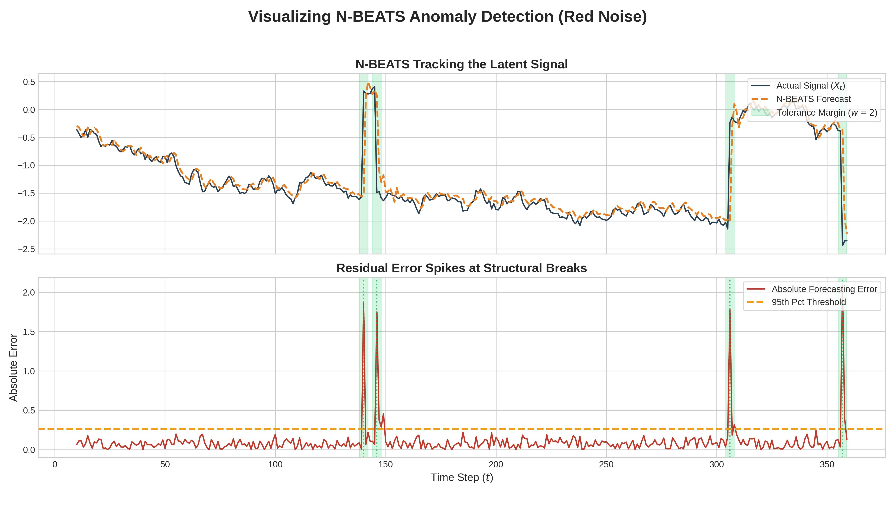
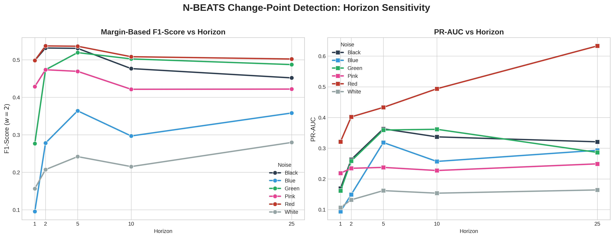
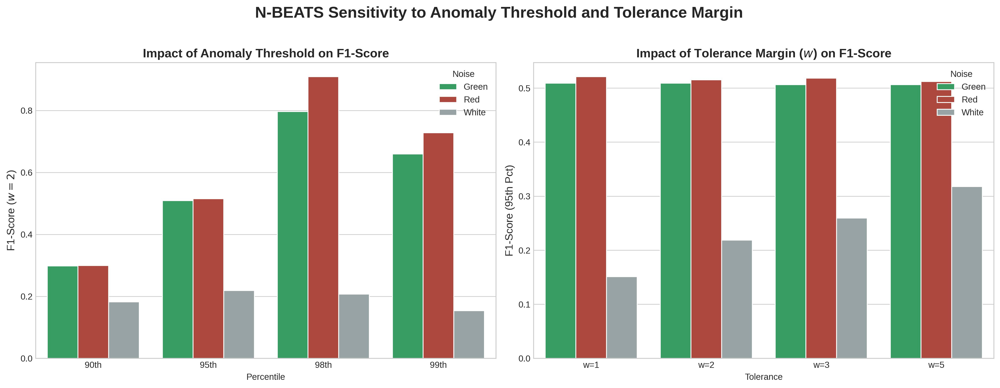
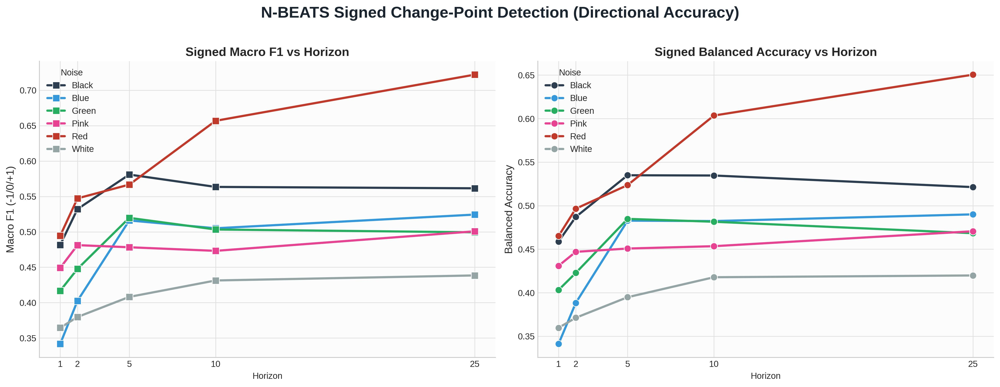
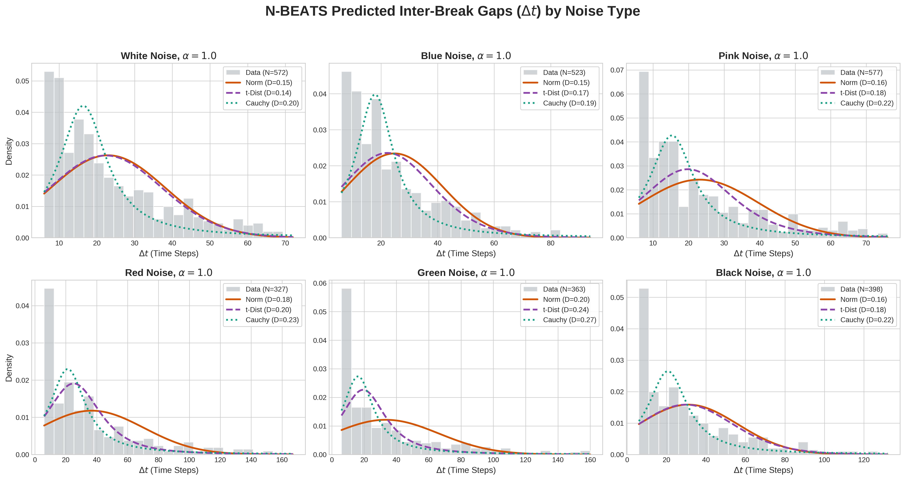

# Can N-BEATS Forecasting Errors Detect Structural Breaks?

Coursework project, 2nd year · HSE University, Faculty of Computer Science, programme "Data Science and Business Analytics"
**Author:** Mikhail Kondrashov · **Supervisor:** Petr Lukianchenko · 2026

## TL;DR

We train N-BEATS only to forecast, never on break labels, and flag a structural break whenever the absolute forecasting error exceeds a high percentile. On synthetic regime-switching series this works well when the background noise is correlated (F1 ≈ 0.51, recall 1.0 for red noise; F1 ≈ 0.9 at the 98th-percentile threshold) and poorly when it is white (F1 = 0.22). The sign of the error also tells the direction of the shift (macro-F1 ≈ 0.7 for red and black noise).



## Research question

Can the residuals of a pure forecasting network serve as a zero-shot, label-free indicator of change points, and how does this depend on the temporal structure of the noise?

## Setup

**Data.** A Binary Telegraph Process: a piecewise-constant signal switching between −α and +α (α ∈ {1, 2}), with geometrically distributed regime lengths, plus noise of six spectral colours: white, pink (1/f), red (1/f²), blue, green, black.

**Model.** A simplified generic N-BEATS (PyTorch): two MLP blocks with the doubly-residual backcast/forecast mechanism. Adam, lr = 0.01, MSE loss, 15 epochs, 80/20 split, look-back horizons h ∈ {1, 2, 5, 10, 25}.

**Detection rule.** A break is flagged at t+1 when |x_{t+1} − x̂_{t+1}| exceeds the 95th (or 98th) percentile of validation errors.

**Evaluation.** Margin-based Precision, Recall and F1 via `ruptures` (a detection counts if it is within w = 2 steps of a true break), plus PR-AUC and ROC-AUC.

## Results

Horizon h = 10, margin w = 2, 95th-percentile threshold:

| Noise | Precision | Recall | F1 | PR-AUC | ROC-AUC |
| --- | --- | --- | --- | --- | --- |
| White | 0.146 | 0.430 | 0.215 | 0.154 | 0.622 |
| Pink | 0.286 | 0.836 | 0.421 | 0.227 | 0.635 |
| Red | 0.346 | 1.000 | 0.508 | 0.494 | 0.718 |
| Blue | 0.202 | 0.585 | 0.297 | 0.257 | 0.694 |
| Green | 0.342 | 0.989 | 0.502 | 0.362 | 0.680 |
| Black | 0.324 | 0.941 | 0.477 | 0.337 | 0.782 |
| **Average** | **0.274** | **0.796** | **0.403** | **0.305** | **0.688** |

Key findings:

- **Noise colour decides everything.** On correlated noise (red, green, black) N-BEATS tracks the slow drift, so a break produces an isolated error spike. On white noise the baseline error is already high and masks the breaks.
- **Short look-back works best.** h ≈ 2–5 makes the network a reactive local filter; longer windows smooth the spike away.
- **A stricter threshold isolates breaks.** At the 98th percentile F1 reaches ≈ 0.9 on red and green noise.
- **The sign of the error carries direction.** Up vs. down shifts are classified with macro-F1 ≈ 0.7 on red and black noise.
- **Inter-break gaps are not heavy-tailed.** For structured noise the fitted Student-t converges to a Normal (same KS distance).

| | |
| --- | --- |
|  |  |
| F1 and PR-AUC vs. look-back horizon | Threshold percentile × tolerance margin |
|  |  |
| Direction of the shift from the error sign | Distribution of predicted inter-break gaps |

## Repository structure

```
NBeats_Pipeline_synth.ipynb   full pipeline: data generator, N-BEATS, experiments, plots
data/                         result tables (core metrics, signed metrics, distribution fits)
graphics/                     figures used in the report
requirements.txt              dependencies
```

## How to run

```bash
git clone https://github.com/Mishan6000/Kondrashov_Coursework_NBEATS.git
cd Kondrashov_Coursework_NBEATS
pip install -r requirements.txt
jupyter notebook NBeats_Pipeline_synth.ipynb
```

Run the cells top to bottom; the N-BEATS experiments are in the "N-BEATS experiments" section. A GPU is not required.

## Limitations and next steps

- Synthetic data only; the next step is real series (financial tick data, temperature anomalies) to check whether the noise-colour dependency holds.
- Baselines from the change-point literature (PELT, Binseg, LSTM-AD) should be compared on the same margin-based metrics.
- One fixed simple architecture and training budget; results may shift with deeper N-BEATS variants.

## References

- Oreshkin et al. N-BEATS: Neural basis expansion analysis for interpretable time series forecasting. ICLR 2020. [arXiv:1905.10437](https://arxiv.org/abs/1905.10437)
- Killick, Fearnhead, Eckley. Optimal detection of changepoints with a linear computational cost. JASA, 2012.
- Truong, Oudre, Vayatis. Selective review of offline change point detection methods. Signal Processing, 2020.
